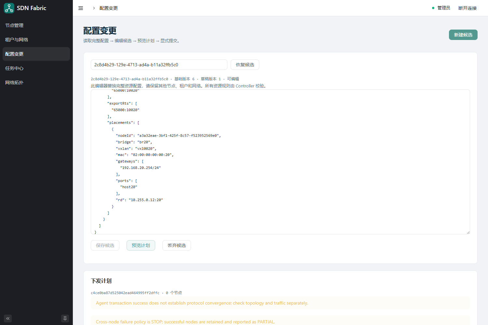

编辑与提交租户网络
================================================================

“租户与网络”提供按 Agent 的资源表单、关系树和运行查询，日常操作见 :doc:`resources`。
本页说明保留的完整 JSON 高级入口。两种入口使用相同的候选、计划和提交机制，资源规则由 Controller 校验。

.. contents:: 本页内容
   :local:
   :depth: 2

哪些配置需要 nodeId
----------------------------------------------------------------

**Web 中提交的网络配置需要 nodeId。** 它使用 Controller 节点列表中注册得到的 UUID，
不是容器名 ``leaf1``、管理 IP、BGP router-id 或 VTEP IP。

.. list-table:: 启动配置与业务配置的区别
   :header-rows: 1
   :widths: 40 60

   * - 配置位置
     - nodeId 的处理
   * - Web 前端 config.js / Gateway 启动参数
     - 不填写 nodeId；只配置 API 地址、Controller 地址、认证和监听等。
   * - Agent 启动文件 agent.conf
     - 不手工分配 nodeId；首次启动生成身份并向 Controller 注册，保存在 Agent 身份卷中。
   * - controller.conf
     - 配置 Controller 与内置 etcd 服务；节点由注册流程发现，不在此文件填写全网 nodeId 清单。
   * - 网络配置 nodes[].nodeId
     - 必须填写该 NodeProfile 所属的已纳管节点 UUID。
   * - tenants[].placements[].nodeId
     - 必须填写部署此租户的目标 Leaf UUID。
   * - networks[].placements[].nodeId
     - 必须填写部署此 BD / L2VNI 的目标 Leaf UUID。
   * - nodeResources[].nodeId
     - 必须填写独立资源所属 Agent 的已注册 UUID；资源表单按所选 Agent 自动携带该值。

操作顺序是：启动 Agent → 在“节点管理”查看 UUID 与 endpoint → 显式纳管 →
把相应 UUID 填入网络配置的上述位置。Web 的“纳管”按钮自动携带所在行的 nodeId，
但完整 JSON 编辑器中的引用仍要填写。一个 Leaf 的 NodeProfile、租户 placement
和网络 placement 必须引用同一个 UUID。

本实验 ``docker/manage.py up`` 读取已注册节点并生成 ``docker/state/evpn.json``，
已经替换这些 UUID，所以复制该完整文件时不用再手填。
自己编写配置或使用仓库静态示例时，必须完成替换；环境 reset 后也要使用新生成的文件。

完整配置与独立节点资源
----------------------------------------------------------------

.. code-block:: json

   {
     "nodes": [],
     "tenants": [],
     "networks": []
   }

这只是旧声明式模型的空配置示意。完整配置还可以包含 ``nodeResources``，其元素为
``{nodeId, objects, bridgePolicies}``。独立资源表单使用此数组；转换后的节点不再同时使用旧声明式部署。
编辑器保存时替换整个候选，不是局部补丁。已有网络上新增资源时，必须保留返回的全部数组，
包括其他节点的 ``nodeResources``，否则可能形成删除计划。

.. list-table:: 配置对象
   :header-rows: 1
   :widths: 20 40 40

   * - 数组
     - 主要内容
     - 典型字段
   * - ``nodes``
     - 节点目标配置、接口地址、OSPF、BGP 邻居和 VTEP
     - ``nodeId``、``role``、``routerId``、``vtepIp``、``asn``、``interfaces``、``peers``
   * - ``tenants``
     - 租户 VRF、L3VNI、RT 和各 Leaf 的三层部署
     - ``id``、``name``、``fabricId``、``l3vni``、``importRts``、``exportRts``、``placements``
   * - ``networks``
     - 二层网络、L2VNI、关联租户和各 Leaf 的 BD/接入口/网关
     - ``id``、``tenantId``、``l2vni``、``importRts``、``exportRts``、``placements``

``nodes`` 中的 ``nodeId`` 引用已注册并纳管的节点 UUID。节点注册清单和此数组分别表达“有哪些节点”与“希望这些节点如何配置”。

租户与二层网络字段
----------------------------------------------------------------

下面是完整配置中一个 Tenant 元素的示意，``<LEAF1_UUID>`` 需要替换；不能把它单独当作完整配置粘贴提交：

.. code-block:: json

   {
     "id": "tenant-a",
     "name": "TENANT-A",
     "fabricId": "lab",
     "l3vni": 50000,
     "importRts": ["65000:1"],
     "exportRts": ["65000:1"],
     "placements": [{
       "nodeId": "<LEAF1_UUID>",
       "tableId": 1001,
       "routerMac": "02:00:00:00:ff:11",
       "bridge": "br50000",
       "vxlan": "vx50000",
       "rd": "10.255.0.11:50000"
     }]
   }

对应的 Network 元素示意：

.. code-block:: json

   {
     "id": "net10",
     "tenantId": "tenant-a",
     "l2vni": 10010,
     "importRts": ["65000:10010"],
     "exportRts": ["65000:10010"],
     "placements": [{
       "nodeId": "<LEAF1_UUID>",
       "bridge": "br10",
       "vxlan": "vx10010",
       "mac": "02:00:00:00:00:10",
       "gateways": ["192.168.10.254/24"],
       "ports": ["host10"],
       "rd": "10.255.0.11:10"
     }]
   }

Tenant 的 placement 描述该节点的 VRF table、L3-SVI Bridge、L3 VXLAN 和 Router MAC；Network 的 placement 描述业务 BD、L2 VXLAN、网关和物理/虚拟接入口。接口名称必须在目标节点中存在或由对应计划创建，``ports`` 引用现有接入口。

节点接口使用 ``addresses`` 表示带前缀长度的 IP，``mtu`` 表示 MTU；``ospf`` 控制接口是否进入 OSPF，``passive`` 用于 loopback 等被动接口。BGP ``peers`` 使用 ``address``、``remoteAs``、``updateSource``、``rrClient``。当前实验的 ``configureSystem: true`` 包含 IPv4 转发等主机配置并关闭 IPv6，不能将该示例当作双栈方案。

保存、计划与提交
----------------------------------------------------------------

1. 在“租户与网络”查看当前版本，点击“编辑配置”，或直接进入“配置变更”。
2. 点击“新建候选”。记录候选 ID 和基础版本。
3. 修改完整 JSON，点击“保存候选”。出现“候选已保存；尚未下发。”说明草稿保存成功。
4. 点击“预览计划”，查看每个节点的基础版本、操作数、展开后的操作内容和警告。
5. 确认影响范围后点击“提交配置”，在弹框中确认。页面跳转到持久化任务。

   计划预览界面示例。截图是已配置环境的无变化计划，显示 0 个节点；首次配置空环境应以实际预览结果为准。

再次修改 JSON 会使原计划失效，需要重新保存和预览。提交时 Controller 重新核对配置、草稿、计划和节点版本。预览成功不表示稍后的提交一定成功。

.. note::

   ``202`` 或跳转到任务页面表示请求已经持久受理。最终成功与否以 Job 和每个节点的结果为准，见 :doc:`jobs-topology`。

恢复草稿和处理并发
----------------------------------------------------------------

重新登录后，“配置变更”会尝试恢复当前标签页记录的候选。也可以在“候选 ID”中输入原 ID，点击“恢复候选”。关闭标签页可能失去本地记录，重要操作应另行保存候选 ID 和 Job ID。

“丢弃候选”只适用于未提交候选，不会撤销已执行的网络配置。已提交候选冻结后，可点击“查看已提交任务”查询结果。

多个操作者使用旧版本提交时会出现冲突。先读取最新完整配置，再将自己的修改合并到新候选；不要以旧快照覆盖其他人的变更。提交超时或 5xx 时保持原请求，通过“重试原提交”找回结果。

当前资源变更边界
----------------------------------------------------------------

Controller 会规划受支持的租户/网络新增和删除，并处理依赖顺序。删除租户前，候选中也必须处理引用它的网络。

当前版本拒绝部分原地身份变更，例如已有 VXLAN/VRF 的身份参数、L3VNI、ASN 或 router ID 变更；受管 NodeProfile 删除也有限制。以计划返回的具体错误为准，不通过直接编辑 Agent 数据库绕过校验。

活动或结果不明的任务会占用相关节点。无关节点可继续接受变更，但完整配置必须保持被占用节点的目标操作不变；计划会提示被排除的节点。回滚失败节点需要先按恢复流程处理。
