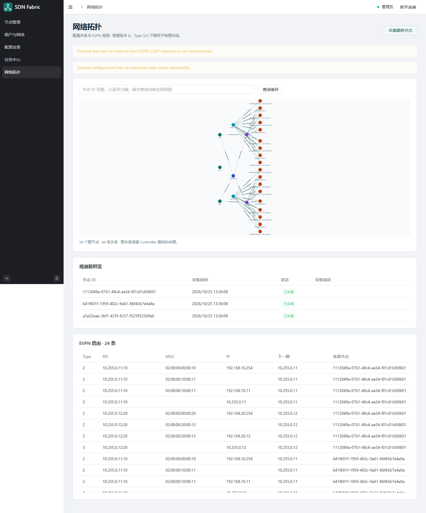

任务结果与网络拓扑
==================

任务中心
--------

提交成功受理后自动跳转到 ``#/jobs?id=<job-id>``。也可以在“任务中心”输入任务 ID，点击“查询任务”，或从任务列表进入详情。

页面显示全局任务状态、目标配置版本、各节点状态/错误和事件记录。列表每页最多 50 个任务，详情最多保留最近 500 条前端事件；后端自身也有事件保留边界，页面数量不代表无限历史审计。

.. list-table:: 常见全局任务状态
   :header-rows: 1
   :widths: 25 75

   * - 状态
     - 如何理解
   * - ``ACCEPTED``
     - Controller 已持久化受理，尚未完成下发
   * - ``STAGING``
     - 正在各节点准备候选
   * - ``APPLYING``
     - 正在提交节点任务并跟踪执行
   * - ``UNKNOWN``
     - 某次调用结果尚不确定，仍需查询恢复；不是已确认失败
   * - ``RECOVERING``
     - 已受理显式的回滚重试，正在恢复失败节点
   * - ``SUCCEEDED``
     - 此计划的配置事务成功；业务连通性仍需验证
   * - ``FAILED``
     - 任务失败，检查节点详情确认是否回到事务前状态
   * - ``PARTIAL``
     - 存在已成功节点或未完整回滚节点；全网没有自动恢复为同一旧版本

节点可能显示 ``FAILED_NO_CHANGE``、``FAILED_ROLLED_BACK``、``ROLLBACK_FAILED`` 等更具体结果。``FAILED_ROLLED_BACK`` 说明该节点回到了事务前状态，原任务仍然失败。``ROLLBACK_FAILED`` 表示还需要恢复，不能当作安全地全部撤销。

SSE 订阅与浏览器断线
------------------------

详情页通过 SSE 接收持久任务事件，按 sequence 去重。订阅中断时页面会查询任务快照并尝试重连；已经结束的任务停止订阅。

关闭页面、Gateway 重启或网络中断不会取消 Controller 中已经受理的 Job。重新登录后使用原 Job ID 查询即可。``UNKNOWN`` 阶段保留原请求和任务 ID，不新建另一份相同变更。

页面事件不是配置执行的唯一依据，最终结果以重新查询到的任务快照和节点状态为准。无法重连时按 :doc:`troubleshooting` 排查 Gateway、Controller 以及 Agent 的连接。

网络拓扑的两类数据
------------------

“网络拓扑”展示 Controller 返回的配置关系与 EVPN 观测。图中的配置关系来自期望配置，EVPN Type-2/Type-3 来自节点 FRR 查询。

.. list-table:: 视图含义
   :header-rows: 1
   :widths: 25 75

   * - 内容
     - 能说明什么
   * - 节点、租户、网络的配置关系
     - 哪个节点被配置为承载哪个租户/网络；不证明数据面已经可达
   * - Type-2
     - MAC 或 MAC-IP 路由及其下一跳，可帮助定位端点的 EVPN 位置
   * - Type-3
     - VTEP 对某二层广播域的参与信息；不等同于 Leaf-Spine 物理连线
   * - 观测时间、stale、error
     - 数据何时采集、是否已过期、哪些节点采集失败

当前没有 LLDP 采集，不能根据 EVPN 自动还原全部物理接线。来源节点不同的同一条路由可能保留多条观测记录，这不表示存在多个独立主机。

   业务配置完成并产生流量后的观测示例。空白环境不会预先出现这些主机和路由。

查询与主动刷新
--------------

* “查询缓存”：读取已有的观测快照，不要求每次页面访问都重新查询 FRR。
* “采集最新状态”：请求 Controller 重新采集所选节点。查看完成后的时间和错误列，部分失败时仍可能保留旧数据。
* “拓扑节点范围”：使用逗号分隔的节点 UUID。留空查询当前全局视图；节点较多时先限定范围。

查看 EVPN 表时，组合检查 Type、RD、MAC、IP、下一跳和来源节点。只有 Type-3 而没有主机 Type-2 时，先确认主机已经发流量、Leaf 已学习本地 MAC/邻居、相关 L2VNI 和 BGP EVPN 正常，再重新采集。

配置成功后的验证顺序
--------------------

1. Job 和对应节点任务是否成功。
2. 观测是否新鲜，是否存在采集错误。
3. OSPF/BGP 邻居和 EVPN Type-2/Type-3 是否符合预期。
4. 从真实业务主机验证网关和跨网段通信。

Web 当前没有内置流量发生器或任意命令终端。实验中的 ping 和 FRR 只读检查在宿主机终端执行，步骤见 :doc:`quickstart`。
