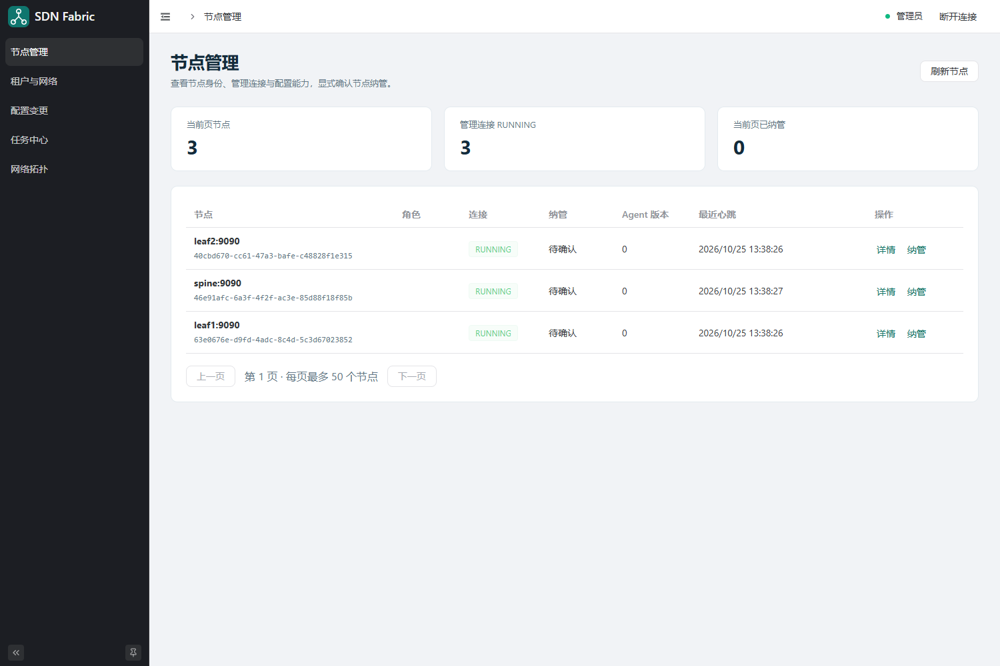

从空白环境开始
==============

本节针对独立的 ``sdn-docker`` 实验。入口为 ``http://<部署服务器IP>:28080``，请把占位符替换为浏览器可访问的部署主机 IP。实验由一个 Spine、两个 Leaf、两个 PC 组成。尚未安装时先完成 :doc:`docker-deploy`；节点启动、注册和接线完成后再按本页配置。

默认部署只有五个核心容器。本页的主机连通性测试需要两台可选 PC，先在 Controller 项目根目录执行：

.. code-block:: bash

   python3 docker/manage.py lab-up

启用后共有七个容器，Leaf 到 PC 的接线才存在。

.. contents:: 本页步骤
   :local:
   :depth: 2

1. 打开控制台并登录
----------------------

浏览器打开 ``http://<部署服务器IP>:28080``。若调整过 Web 映射端口，使用实际端口。在“访问令牌”输入框填入管理员令牌，点击“连接控制台”。

本次 Docker 环境的令牌文件位于：

* 部署主机：Controller 项目目录下的 ``docker/state/tokens.json``，例如 ``~/program/github/sdn-controller/docker/state/tokens.json``。
* 远程浏览器操作者：由部署管理员提供相应角色的令牌；若通过共享目录读取，使用自己挂载的路径，不要求固定盘符或用户名。

使用该文件的 ``admin`` 字段值；``viewer`` 只用于查看。输入的是字段中的字符串内容，不包括引号、字段名或整个 JSON。令牌的详细用途见 :doc:`nodes-access`。

.. note::

   旧实验的 ``18080`` 和 ``lab/state/tokens.json`` 属于另一套部署。当前指南使用 ``28080`` 和 ``docker/state/tokens.json``，两套环境不要混用。

成功后进入“节点管理”，右上角显示“管理员”。刷新整个浏览器页面后需要重新输入令牌。

2. 确认并纳管三个节点
------------------------

初始空白环境应显示三个节点，连接为 ``RUNNING``，纳管为“待确认”，Agent 版本为 ``0``。它们的 endpoint 分别为 ``spine:9090``、``leaf1:9090`` 和 ``leaf2:9090``；尚未配置时，角色栏可能为空。

   历史实验清空后的节点页。截图中的地址、UUID 仅为当时记录，操作时以实际部署和当前页面为准。

依次点击每个节点的“详情”，核对 endpoint、UUID 和操作能力；随后点击“纳管”，在对话框中点击“确认纳管”。空白节点保持“允许接管已有配置”未勾选。

记录各节点的 UUID：它就是后续网络配置的 ``nodeId``。纳管按钮会自动携带当前行的 UUID；
自己填写 JSON 时则需要把它写入 ``nodes[].nodeId``、租户与网络的 ``placements[].nodeId``。
``spine`` / ``leaf1`` 等名字和 ``10.255.0.x`` 地址都不能替代 UUID。

纳管完成后，“当前页已纳管”为 ``3``。``RUNNING`` 只表示管理连接正常，尚不代表 OSPF、BGP 或业务流量已经正常。

3. 编辑、保存并预览配置
--------------------------

打开“配置变更”，点击“新建候选”。系统读取当前完整期望配置作为编辑起点。

本次实验的完整配置文件为 ``sdn-controller/docker/state/evpn.json``。它由环境管理脚本按当前节点 UUID 生成。把其完整内容粘贴到“完整资源配置 JSON”编辑框，点击“保存候选”，再点击“预览计划”。

因此这个生成文件已经包含所需的 ``nodeId``，并非省略节点身份。
Web / Gateway 的启动配置不需要 nodeId；业务 JSON 需要，具体字段见 :doc:`configuration`。

目标配置包括：

.. list-table:: 本实验网络规划
   :header-rows: 1
   :widths: 30 70

   * - 对象
     - 取值
   * - Router ID / Leaf VTEP
     - Spine Router ID ``10.255.0.1``；Leaf1/2 的 Router ID 及 VTEP 为 ``10.255.0.11/12``
   * - Underlay
     - ``10.0.1.0/30``、``10.0.2.0/30``，OSPF 发布链路与 loopback
   * - BGP
     - ASN ``65000``，Spine 作为 EVPN 路由反射器
   * - 租户
     - ``TENANT-A``，VRF table ``1001``，L3VNI ``50000``，RT ``65000:1``
   * - Leaf1 二层网络
     - L2VNI ``10010``，``br10``，网关 ``192.168.10.254/24``，接入口 ``host10``
   * - Leaf2 二层网络
     - L2VNI ``10020``，``br20``，网关 ``192.168.20.254/24``，接入口 ``host20``

Spine 在本实验中提供 Underlay 路由和 EVPN 路由反射，不作为 VTEP。查看计划中的三个节点、Agent 基础版本、操作数量和警告。展开节点行可以查看编译后的 Linux/FRR 操作。此时尚未向节点下发。

.. important::

   ``evpn.json`` 必须与当前环境匹配。执行过实验 reset 后，节点 UUID 会改变，要重新读取生成的文件。不要把示例中的 ``leaf1`` 字符串当作实际 ``nodeId``，也不要复制截图中的 UUID。

4. 提交并等待任务
--------------------

点击“提交配置”，在确认框中确认。成功受理后页面跳转到“任务中心”，保留显示的 Job ID。

等待全局任务状态为 ``SUCCEEDED``，并查看三个节点各自的执行状态。若出现 ``UNKNOWN``、``FAILED`` 或 ``PARTIAL``，按 :doc:`troubleshooting` 处理，不用重复新建候选尝试碰运气。

“租户与网络”会显示 Controller 的期望版本和资源。期望配置已保存与节点执行完毕是不同的阶段，以任务结果确认下发情况。

5. 配置 PC 并验证业务
----------------------------

PC 不运行 Agent，Web 不配置它们。管理员在本实验的 Docker 部署宿主机终端执行：

.. code-block:: bash

   cd ~/program/github/sdn-controller
   python3 docker/manage.py hosts
   docker exec sdn-docker-pc1 ping -c 3 192.168.10.254
   docker exec sdn-docker-pc2 ping -c 3 192.168.20.254
   docker exec sdn-docker-spine vtysh -c 'show bgp l2vpn evpn'
   docker exec sdn-docker-pc1 ping -c 3 192.168.20.12
   docker exec sdn-docker-pc2 ping -c 3 192.168.10.11

``hosts`` 会实际配置本实验两台 PC；ping 网关产生主机学习流量。等待协议收敛后，应能看到业务 Type-2、Type-3 路由，并完成两个 PC 的双向通信。

回到“网络拓扑”，点击“采集最新状态”，检查观测时间、采集错误和 EVPN 路由表。任务成功、协议收敛和业务可达需要分别确认，详见 :doc:`jobs-topology`。

保留环境还是清空
----------------

关闭浏览器不会清除网络。若需要继续手工验证，保留当前环境即可。

只有明确要重新开始本实验时，才在 Controller 项目目录执行：

.. code-block:: bash

   python3 docker/manage.py reset
   python3 docker/manage.py clean-check

``reset`` 会重建本 Compose 项目的容器和数据卷，清除配置、任务和旧节点身份；它保留镜像、凭据及测试报告。该操作与文档的 ``make -C docs clean`` 完全不同：后者只清理 HTML 文档产物。
